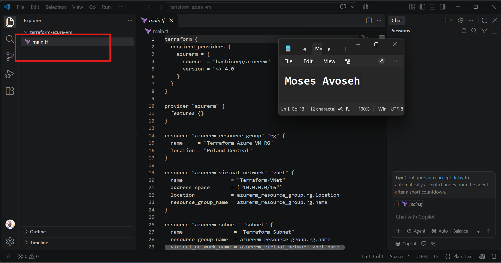
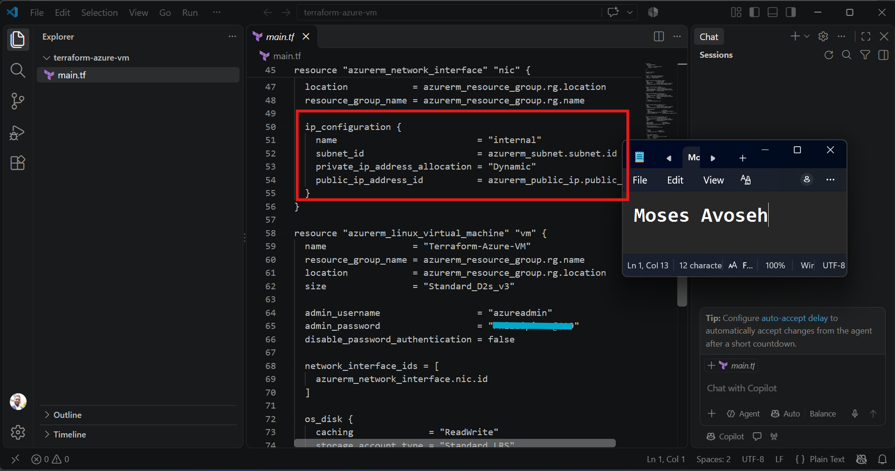
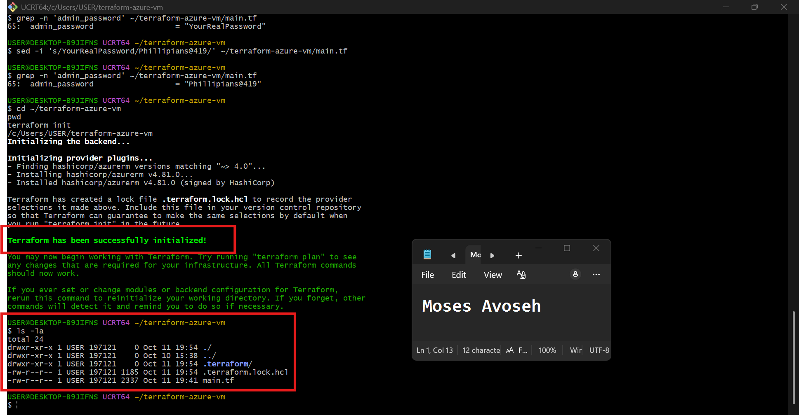
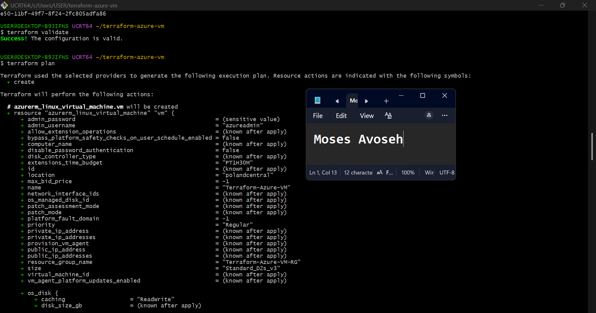
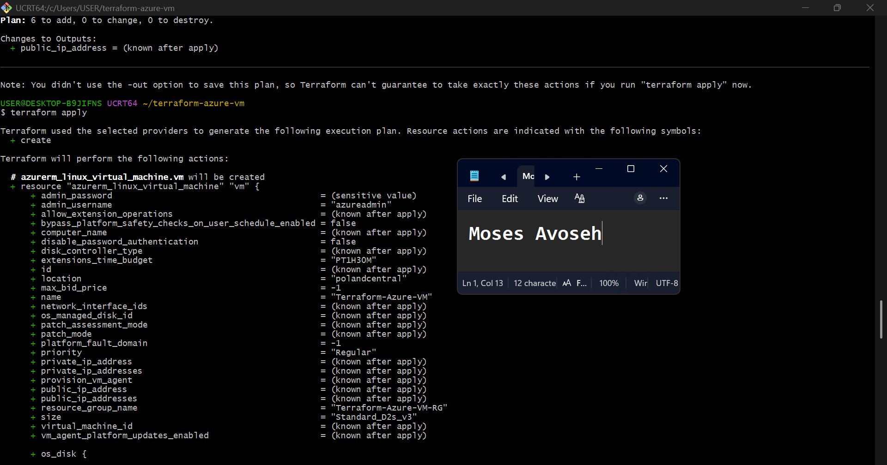
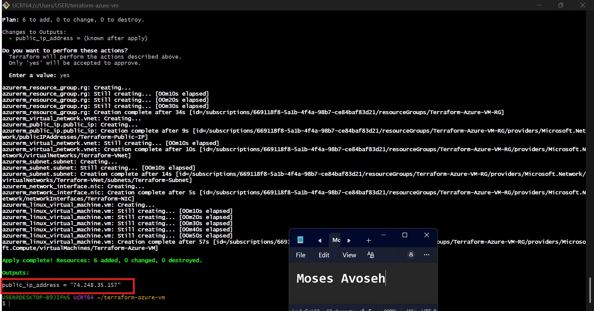
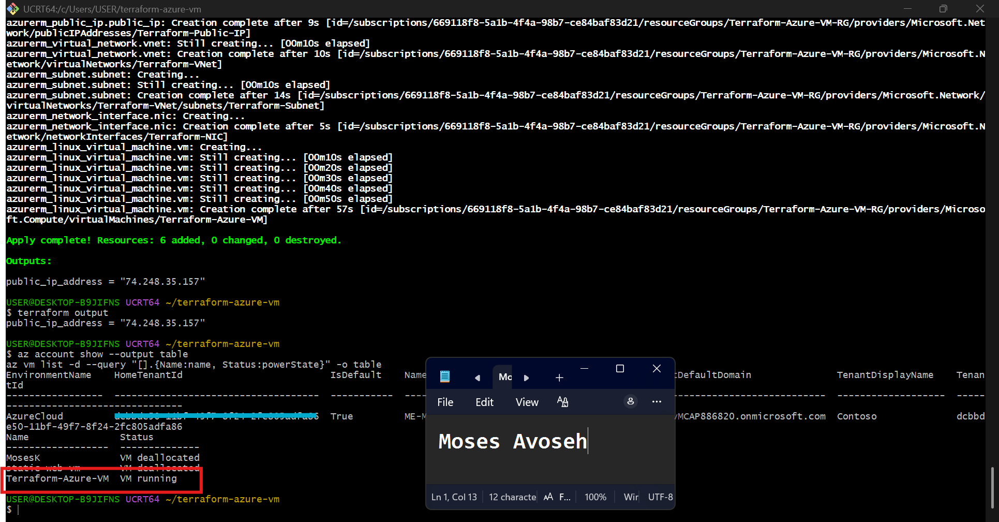
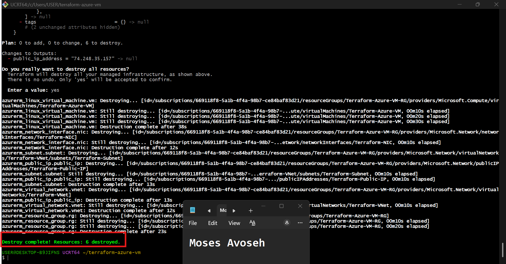

# Assignment 1 — Create an Azure Virtual Machine using Terraform

Part of the DevOps Micro Internship (DMI) Cohort 3 with Agentic AI

---

## Purpose

In this assignment, you will use Terraform to provision a complete Azure Virtual Machine environment: a resource group, virtual network, subnet, public IP, network interface, and an Ubuntu 18.04 Linux VM. You will initialize, plan, and apply the configuration, verify the running VM via Azure CLI, and destroy the resources after testing.

---

# Task 1 — Create a New Terraform Project and Define the Infrastructure

## Goal

Create a `terraform-azure-vm` project and define the resource group, virtual network, subnet, public IP, network interface, and Ubuntu 18.04 VM (with username/password authentication and a public IP output) in `main.tf`.

### Evidence

#### Screenshot 1 — VS Code showing `main.tf` and the required Azure resources

---

#### Screenshot 2 — `main.tf` showing the public IP output and VM authentication configuration, with the password hidden or redacted

---

# Task 2 — Initialize Terraform

## Goal

Run `terraform init` and confirm the working directory initializes successfully.

### Evidence

#### Screenshot 3 — Terminal showing successful `terraform init` output

---

# Task 3 — Plan and Apply the Configuration

## Goal

Review `terraform plan`, run `terraform apply`, and record the VM's public IP from the Terraform output.

### Evidence

#### Screenshot 4 — Terraform plan summary showing the proposed resources

---

#### Screenshot 5 — Terraform apply output showing successful completion

---

#### Screenshot 6 — Terraform output showing the public IP of the VM

---

# Task 4 — Verify the Deployment

## Goal

Use Azure CLI to confirm the VM was created and is running.

### Evidence

#### Screenshot 7 — Azure CLI output showing the VM name and running status

---

# Task 5 — Destroy the Resources

## Goal

Run `terraform destroy` to clean up the Azure resources after testing.

### Evidence

#### Screenshot 8 — Terminal showing successful `terraform destroy` completion

---

### Notes

Write a short paragraph explaining what you learned or any issues you encountered.

In this assignment I used Terraform to deploy an Azure environment as code: a resource group, virtual network, subnet, public IP, network interface and Ubuntu Linux VM, with the public IP exposed as an output. I learned that writing main.tf only describes the infrastructure, and nothing exists in Azure until terraform apply runs, which is why the resource group didn’t appear in the portal at first. The workflow of init, validate, plan and apply helped me catch problems before anything was created. I ran into a few issues along the way. Terraform wouldn’t run at first because I had downloaded the macOS build instead of the Windows one, and Git Bash couldn’t find the executable until I put it in a folder on my PATH. I also hit VM size capacity errors in some regions on my subscription, so I deployed to Poland Central with a different VM size than the example. The sample password also didn’t meet Azure’s complexity rules, so I used a stronger one and hid it in my screenshots. Overall, this showed me how Terraform makes infrastructure repeatable, and that terraform destroy gives a clean way to remove everything afterward and avoid unnecessary charges.

---

# Submission Instructions

- Add all required screenshots in your submission
- Include the VM public IP from the Terraform output
- Do not expose Azure credentials, subscription details, or passwords

---

# Completion Checklist

- [✅ Completed] Task 1: `terraform-azure-vm` project created with all required resources defined (Screenshots 1–2)
- [✅ Completed] Task 2: `terraform init` completed successfully (Screenshot 3)
- [✅ Completed] Task 3: Plan reviewed and `terraform apply` completed, public IP recorded (Screenshots 4–6)
- [✅ Completed] Task 4: VM verified as running via Azure CLI (Screenshot 7)
- [✅ Completed] Task 5: `terraform destroy` completed successfully (Screenshot 8)
- [✅ Completed] Learning/issues paragraph written (Notes)
- [✅ Completed] No sensitive information exposed

---

## 📌 About DMI & CloudAdvisory

DevOps Micro Internship (DMI) is a project-based DevOps program run by Pravin Mishra (The CloudAdvisory) focused on real-world execution, systems thinking, and career readiness.

It helps learners build strong DevOps foundations with hands-on experience.

---

## 📌 Resources

- 🌐 DMI Official Website: https://dmi.pravinmishra.com?utm_source=github&utm_medium=readme  
- 🎓 University: https://university.pravinmishra.com?utm_source=github&utm_medium=readme  
- 💬 Discord Community: https://discord.pravinmishra.com?utm_source=github&utm_medium=readme  
- 📝 Blog: https://dmi.pravinmishra.com/blog?utm_source=github&utm_medium=readme  
- ▶️ YouTube Playlist: https://www.youtube.com/playlist?list=PLFeSNDtI4Cho  
- 🔗 Pravin Mishra (LinkedIn): https://www.linkedin.com/in/pravin-mishra-aws-trainer/  
- 🏢 CloudAdvisory (LinkedIn): https://www.linkedin.com/company/thecloudadvisory/

---

*This submission is part of DevOps Micro Internship (DMI) Cohort 3 — Agentic AI Track.*
