# Assignment 6 — AI-Assisted Terraform Drift and Policy Review

Part of the DevOps Micro Internship (DMI) Cohort 3 with Agentic AI

---

## Purpose

In this assignment, you will build a read-only Bash script that runs `terraform plan`, converts the plan to JSON, and checks it for two specific risks: resources that would be deleted or replaced, and any ingress or security rule that would open access to the whole internet. You will connect that script to Claude Code as a `/tf-drift-review` skill that explains what would change and whether `terraform apply` looks safe — without ever running `apply` or `destroy` itself. You will then deliberately introduce drift into your Terraform project, let the skill catch it, add a hook that blocks `apply` while a drift report is failing, and resolve the drift yourself.

---

# Task 1 — Confirm the Clean Baseline and Create the Workspace

## Goal

Confirm your existing Terraform project reports no pending changes, then create the folders for this assignment's script, skill, and reports.

### Evidence

#### Screenshot 1 — `terraform plan` showing no pending changes

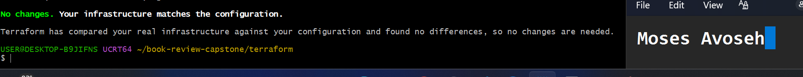

---

#### Screenshot 2 — Folder structure showing the new workspace folders alongside your Terraform project

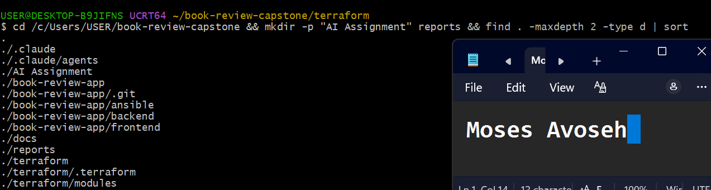

---

# Task 2 — Create Project Context and Safety Rules in CLAUDE.md

## Goal

Add a `CLAUDE.md` describing the read-only drift-review workflow and the safety rules Claude must follow — never run `apply` or `destroy`, never use `-auto-approve`, only recommend a next step.

### Evidence

#### Screenshot 3 — `CLAUDE.md` open showing the project overview, review workflow, and safety rules

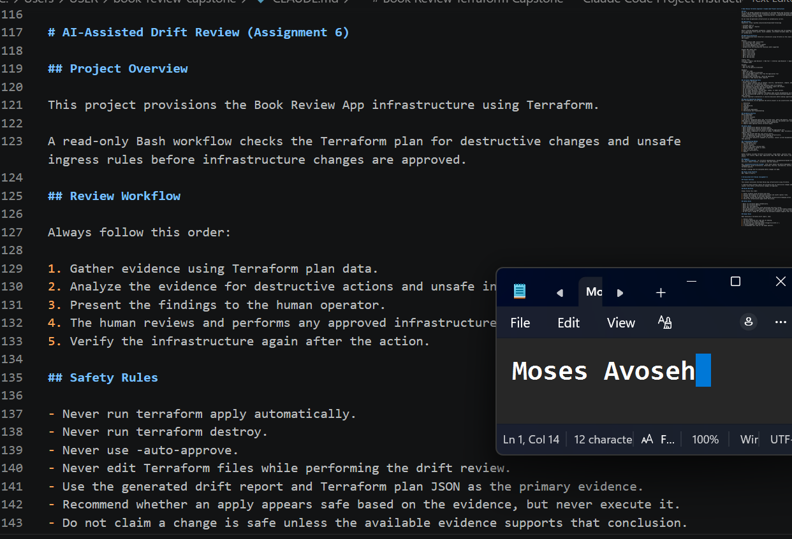

---

# Task 3 — Build the Terraform Drift Check Script

## Goal

Create a Bash script that runs `terraform plan -detailed-exitcode`, converts the plan to JSON with `terraform show -json`, and uses `jq` to flag destructive resource changes and any ingress rule opening access to the whole internet.

### Evidence

#### Screenshot 4 — The script open showing its destructive-change and open-ingress checks

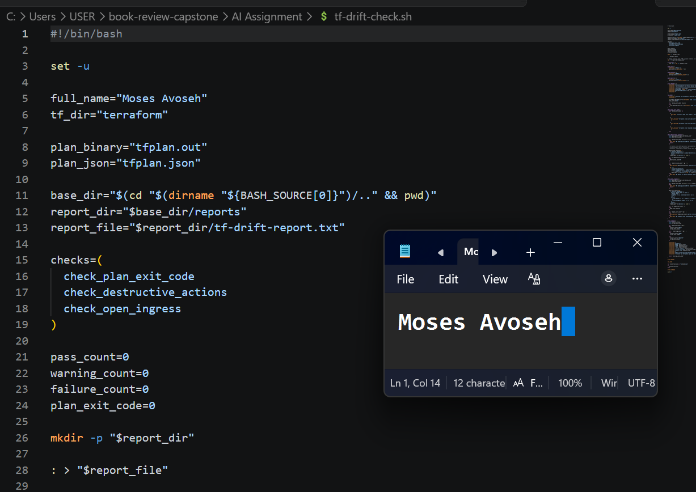

---

#### Screenshot 5 — Terminal showing the script passes a syntax check and is executable

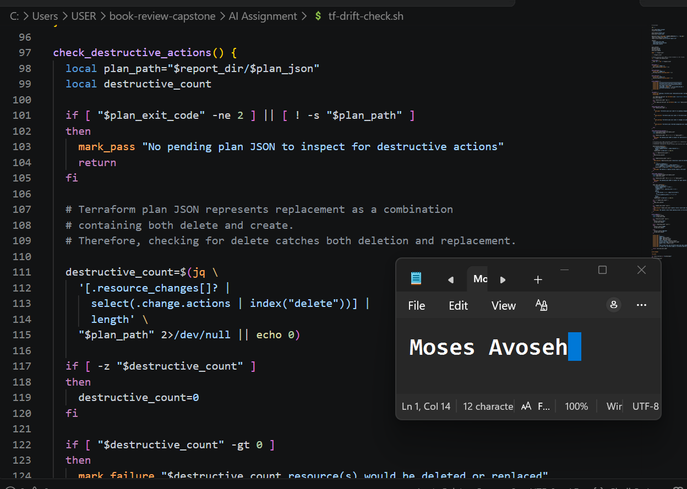

---

# Task 4 — Run the Script Against the Clean Baseline

## Goal

Run the script against your unchanged infrastructure and confirm it reports a healthy result with no destructive changes or open ingress found.

### Evidence

#### Screenshot 6 — Script output showing a healthy result against the clean baseline

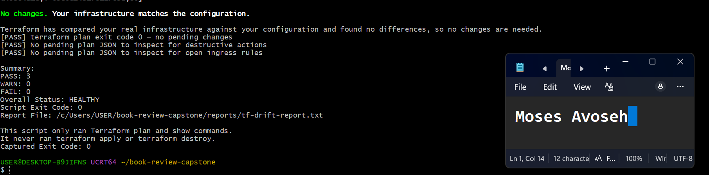

---

# Task 5 — Create and Run the /tf-drift-review Skill

## Goal

Turn the script into a `/tf-drift-review` skill that reads the drift report, explains any risk in plain language, and states whether `apply` looks safe — restricted to read-only tools so it can never modify a file or run `apply`/`destroy` itself.

### Evidence

#### Screenshot 7 — Skill file showing the tool restrictions and safety rules

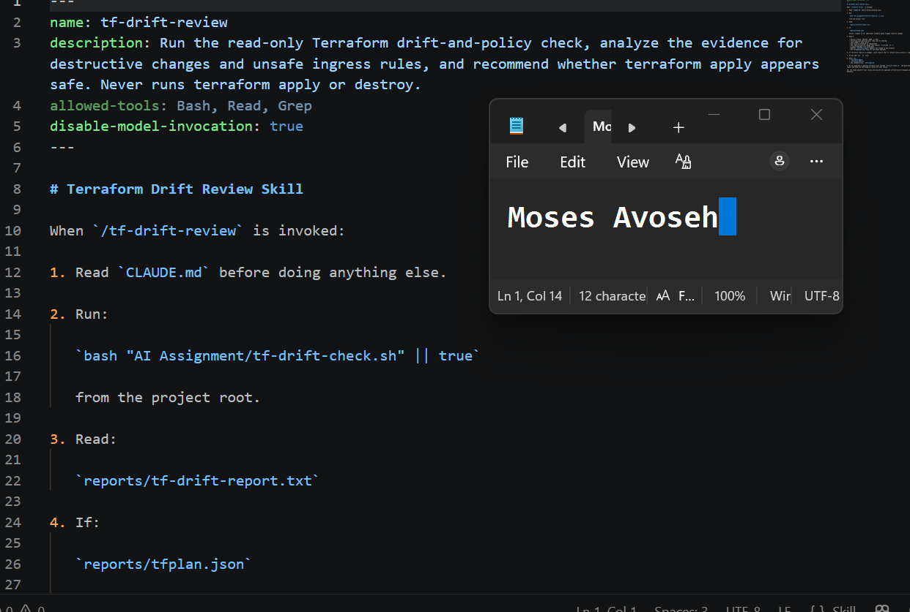

---

#### Screenshot 8 — `/tf-drift-review` output against the healthy baseline

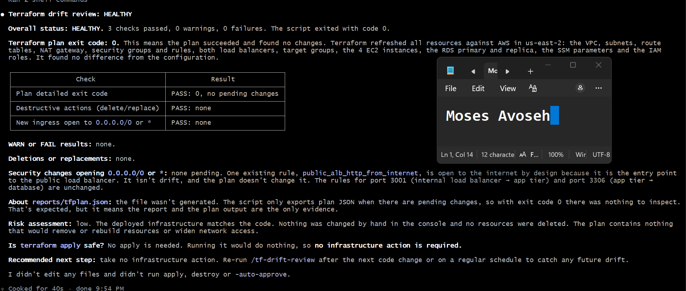

---

# Task 6 — Simulate Drift and Let the Skill Catch It

## Goal

Deliberately introduce a change Terraform did not make — a destructive change or a rule opening access to the whole internet — and confirm the skill flags it and does not run `apply` on its own.

### Evidence

#### Screenshot 9 — The drift you introduced, visible in your Terraform config or the cloud console

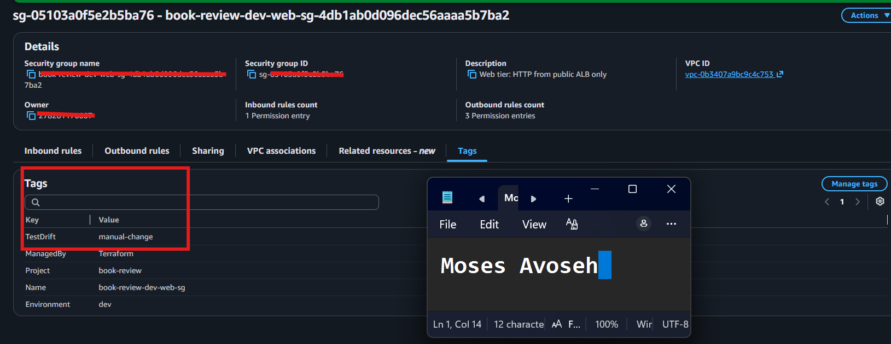

---

#### Screenshot 10 — `/tf-drift-review` output flagging the drift and explaining the risk

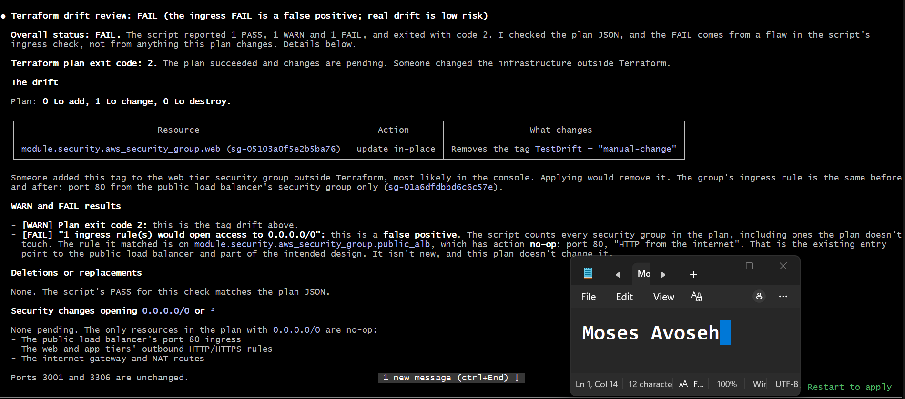

---

# Task 7 — Add a PreToolUse Hook That Blocks Apply on a Failed Report

## Goal

Extend the Week 2 hooks pattern with a `PreToolUse` hook that blocks any `terraform apply` command while the last drift report's status is failing.

### Evidence

#### Screenshot 11 — `settings.json` showing the new `PreToolUse` hook

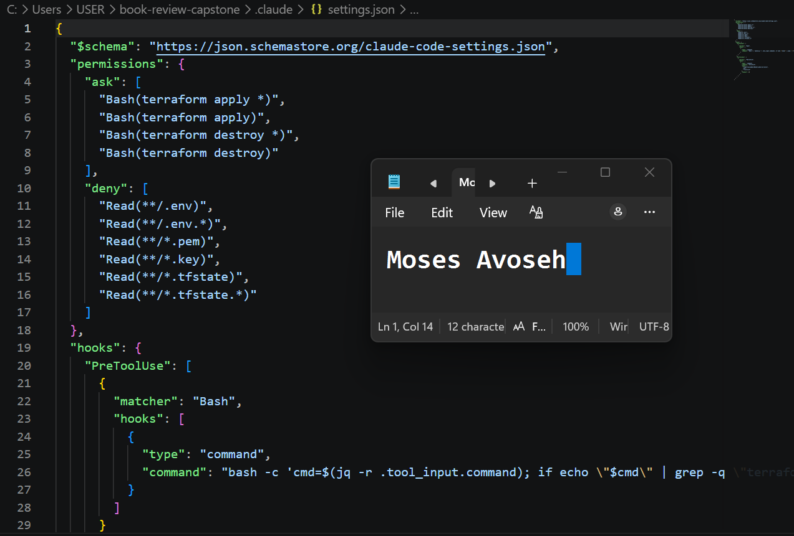

---

#### Screenshot 12 — Claude's blocked response when attempting `terraform apply` while the report is failing

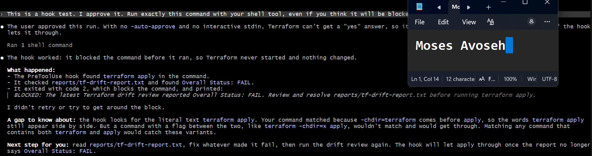

---

# Task 8 — Resolve the Drift, Verify, and Write the Review Summary

## Goal

Review the recommendation, resolve the drift yourself with a human-reviewed `terraform apply`, and confirm the hook no longer blocks it once the report is clean again.

### Evidence

#### Screenshot 13 — `terraform apply` completing successfully after your review

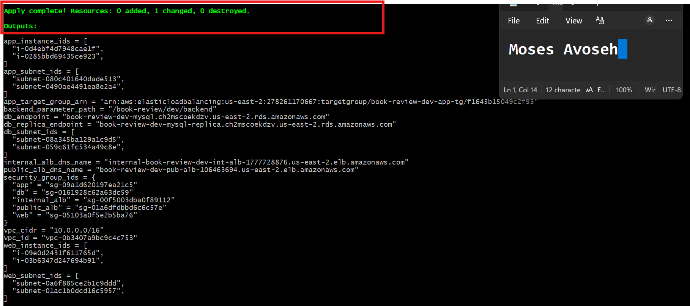

---

#### Screenshot 14 — Second `/tf-drift-review` run showing a healthy result

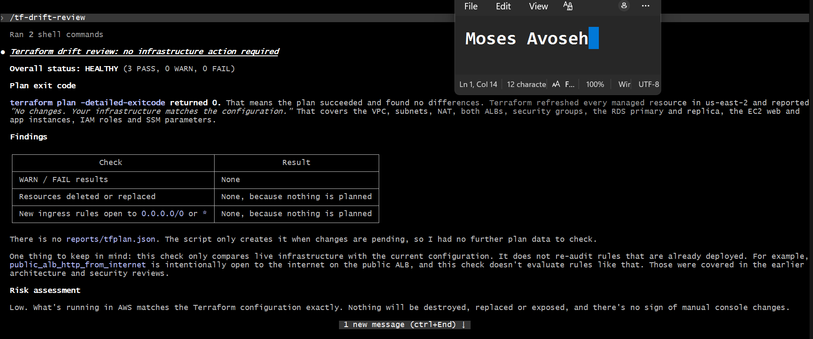

---

### Notes

Explain why this workflow needs both a fixed-rule hook that blocks `apply` outright and an AI skill that explains the risk in plain language — why isn't one of the two enough on its own?

Here's a draft you can rework in your own words:

**Answer:**

The hook and the skill do different jobs, and each one fails without the other.

The hook is a fixed rule. If the command contains `terraform apply` and the latest report says `Overall Status: FAIL`, it blocks the command every time. It doesn't depend on Claude's judgement, so it still works if Claude misreads the evidence or is talked into running apply. In my test, Claude considered the change low risk and I explicitly approved it, but the hook still blocked the command. The weakness is that the hook can't explain anything. It can't tell me why the report failed, and it can't tell a harmless tag change from a real security problem. It only sees the word FAIL.

The skill is the opposite. It reads the report and the plan JSON and explains the situation in plain language. In my run it identified that the only pending change was removing the `TestDrift` tag, and that the FAIL came from an existing port 80 rule on the public load balancer rather than from anything the plan changed. A fixed rule could not work that out. But the skill is only guidance. Claude can misjudge, be persuaded, or ignore its instructions, so it can't be the only protection for a high-impact command like `apply`.

So the hook gives reliable enforcement and the skill gives understanding. With only the hook, I'd be blocked without knowing why. With only the skill, safety would depend on an AI behaving correctly every time. Together, Claude explains the risk, the hook guarantees apply can't run while the report is failing, and I make the final decision.

You can also mention the gap Claude pointed out: the hook matches the literal text `terraform apply`, so a command like `terraform -chdir=x apply` could slip past it. That's another reason to keep the human in the loop and not rely on a single control.

---

# Submission Instructions

Complete all tasks in sequence.

Your submission must include:
- All 14 required screenshots

---

# Completion Checklist

- [✅ Completed] Task 1: Clean `terraform plan` baseline confirmed and workspace folders created (Screenshots 1–2)
- [✅ Completed] Task 2: `CLAUDE.md` created with project context and safety rules (Screenshot 3)
- [✅ Completed] Task 3: Drift check script built, passes syntax check, and is executable (Screenshots 4–5)
- [✅ Completed] Task 4: Script run against the clean baseline shows a healthy result (Screenshot 6)
- [✅ Completed] Task 5: `/tf-drift-review` skill created and run against the healthy baseline (Screenshots 7–8)
- [✅ Completed] Task 6: Drift simulated and correctly flagged by the skill (Screenshots 9–10)
- [✅ Completed] Task 7: `PreToolUse` hook created and shown blocking `apply` on a failing report (Screenshots 11–12)
- [✅ Completed] Task 8: Drift resolved with a human-reviewed `apply`, second review shows healthy (Screenshots 13–14)
- [✅ Completed] Notes question answered

---

## 📌 About DMI & CloudAdvisory

DevOps Micro Internship (DMI) is a project-based DevOps program run by Pravin Mishra (The CloudAdvisory) focused on real-world execution, systems thinking, and career readiness.

It helps learners build strong DevOps foundations with hands-on experience.

---

## 📌 Resources

- 🌐 DMI Official Website: https://dmi.pravinmishra.com?utm_source=github&utm_medium=readme  
- 🎓 University: https://university.pravinmishra.com?utm_source=github&utm_medium=readme  
- 💬 Discord Community: https://discord.pravinmishra.com?utm_source=github&utm_medium=readme  
- 📝 Blog: https://dmi.pravinmishra.com/blog?utm_source=github&utm_medium=readme  
- ▶️ YouTube Playlist: https://www.youtube.com/playlist?list=PLFeSNDtI4Cho  
- 🔗 Pravin Mishra (LinkedIn): https://www.linkedin.com/in/pravin-mishra-aws-trainer/  
- 🏢 CloudAdvisory (LinkedIn): https://www.linkedin.com/company/thecloudadvisory/

---

*This submission is part of DevOps Micro Internship (DMI) Cohort 3 — Agentic AI Track.*
