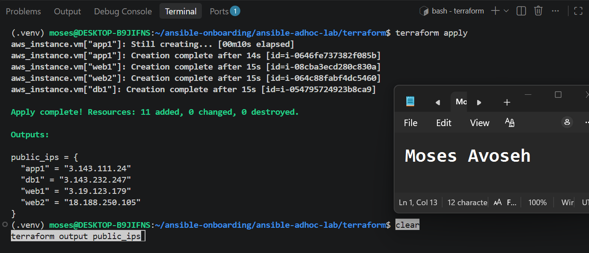
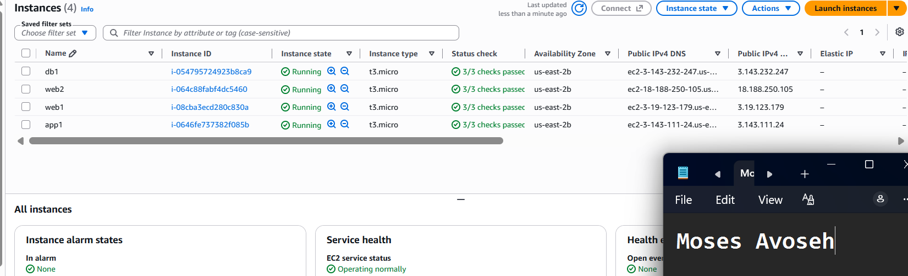
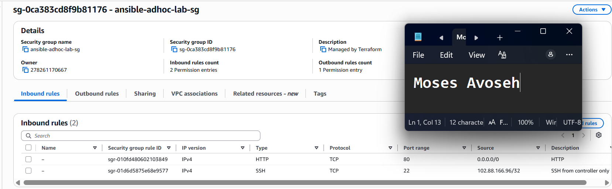
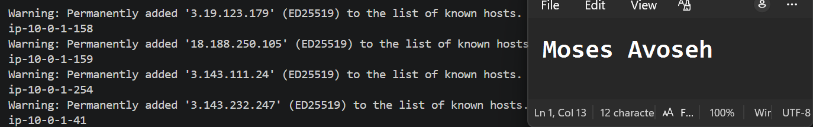
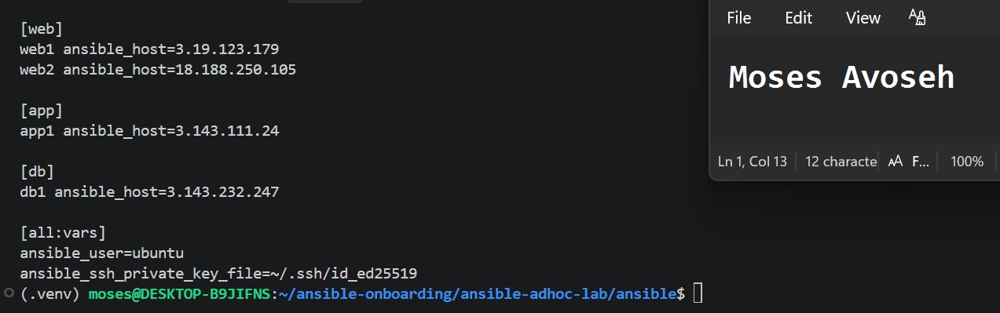
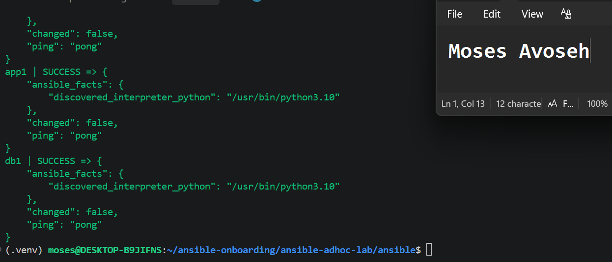
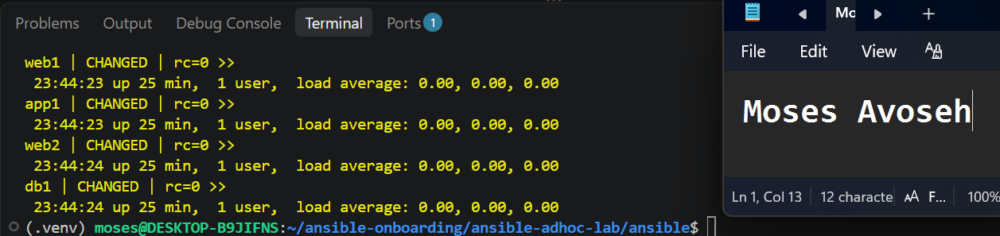
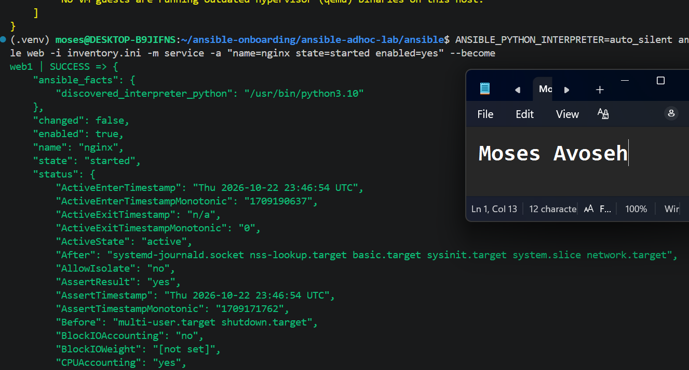
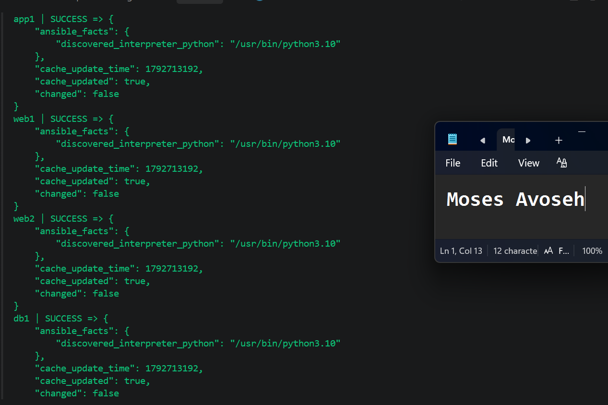

# Assignment 2 — Ad-Hoc Automation on Azure: 4 VMs, Inventory & Passwordless SSH

Part of the DevOps Micro Internship (DMI) Cohort 3 with Agentic AI

---

## Purpose

In this assignment, you will provision four Azure Linux VMs with Terraform, configure passwordless SSH, build a custom Ansible inventory with web/app/db groups, and run ad-hoc commands across individual hosts and groups.

---

# Task 1 — Provision 4 Azure VMs (Terraform)

## Goal

Provision four Ubuntu 22.04 VMs (`web1`, `web2`, `app1`, `db1`, Standard_B1s) with SSH key authentication and public IPs, in a VNet with an NSG allowing SSH (22) and HTTP (80), and output all four public IPs.

### Evidence

#### Screenshot 1 — Terminal showing successful `terraform apply` output and `terraform output public_ips`

---

#### Screenshot 2 — Azure Portal showing all four running Ubuntu VMs

---

#### Screenshot 3 — Network Security Group inbound rules showing SSH 22 and HTTP 80

---

# Task 2 — Configure Passwordless SSH

## Goal

Connect to each of the four VMs as `azureuser` and run `hostname` remotely without a password prompt.

### Evidence

#### Screenshot 4 — Terminal showing successful `hostname` output from all four passwordless SSH tests

---

# Task 3 — Create a Custom Ansible Inventory

## Goal

Create `inventory.ini` mapping VM indices 0–1 to `[web]`, index 2 to `[app]`, and index 3 to `[db]`, with `ansible_user` and `ansible_ssh_private_key_file` set under `[all:vars]`.

### Evidence

#### Screenshot 5 — Editor or terminal showing `inventory.ini` with the web, app, db, and all:vars sections

---

# Task 4 — Run Your First Ansible Ad-Hoc Commands

## Goal

Run `ping`, `whoami`, and `uptime` against all hosts; install and start Nginx on the `web` group with `--become`; install `htop` on all hosts; and run `df -h` on `db` and `free -m` on all hosts.

### Evidence

#### Screenshot 6 — Terminal showing `ansible ping` SUCCESS for all four hosts

---

#### Screenshot 7 — Terminal showing `uptime` output for all four hosts

---

#### Screenshot 8 — Terminal showing Nginx installation and service start on the web group

---

#### Screenshot 9 — Terminal showing `htop` installation on all hosts and group-targeted command output

---

### Notes

Describe an issue you faced and how you fixed it, what you learned, when you'd use an ad-hoc command instead of a playbook, and one challenge you faced during SSH or inventory setup.

### Notes

**Platform note:** I completed this assignment on AWS (Ohio, us-east-2) instead of Azure. Where the template mentions Azure terms, I used the AWS equivalents: Security Group instead of Network Security Group, EC2 t3.micro instead of Standard_B1s, and the SSH user "ubuntu" instead of "azureuser". Terraform created four Ubuntu 22.04 instances (web1, web2, app1, db1) with for_each over a vm_roles variable.

**Issue I faced and how I fixed it:** terraform validate failed with "invalid value for name (cannot begin with sg-)". AWS reserves the "sg-" prefix for its own security group IDs, so the required name sg-ansible-adhoc-lab could not be used as the group's actual name. I set the group name to ansible-adhoc-lab-sg and kept sg-ansible-adhoc-lab as the Name tag, which is what shows in the console. validate then passed.

**SSH / inventory challenge:** When testing SSH, I pasted the commands with the literal placeholders (ssh ubuntu@<WEB1_IP>). Bash treated "<" as file redirection and returned "No such file or directory". I fixed it by running terraform output public_ips and substituting the real IP addresses. For the inventory, I used ansible_host so each friendly name (web1, web2, app1, db1) maps to its public IP, and I put ansible_user and ansible_ssh_private_key_file under [all:vars].

**What I learned:** Terraform's for_each creates all four VMs from one resource block, and a role-to-IP output map ties each IP to an inventory group. An Ansible inventory groups servers by role, so one command can target one group (web) or the whole fleet (all). The ping module checks that Ansible can log in over SSH and run Python, not ICMP reachability. Package and service tasks need --become because they require root privileges. Modules such as apt and service are idempotent, so rerunning them reports changed: false when the system already matches the desired state.

**Ad-hoc command vs playbook:** I would use an ad-hoc command for quick, one-time tasks such as checking uptime, disk or memory, testing connectivity, or installing a single package. I would use a playbook for repeatable, multi-step configuration that needs to be version-controlled, reviewed, and run consistently on many servers.

**Other deviations:** Port 80 is open to 0.0.0.0/0 on a single shared security group, so it applies to all four VMs rather than only the web hosts. SSH (port 22) is restricted to my controller's /32 address. The VMs are all public, so no jump host was needed.

---

# Submission Instructions

- Add all required screenshots in your submission
- Public IP addresses may be redacted
- Do not expose, upload, or commit the SSH private key

---

# Completion Checklist

- [✅ Completed] Task 1: Four Azure VMs provisioned with Terraform (Screenshots 1–3)
- [✅ Completed] Task 2: Passwordless SSH verified on all four VMs (Screenshot 4)
- [✅ Completed] Task 3: `inventory.ini` created with web/app/db groups (Screenshot 5)
- [✅ Completed] Task 4: Ad-hoc ping, uptime, Nginx, and htop commands run successfully (Screenshots 6–9)
- [✅ Completed] Reflection notes written (Notes)
- [✅ Completed] No private key material exposed

---

## 📌 About DMI & CloudAdvisory

DevOps Micro Internship (DMI) is a project-based DevOps program run by Pravin Mishra (The CloudAdvisory) focused on real-world execution, systems thinking, and career readiness.

It helps learners build strong DevOps foundations with hands-on experience.

---

## 📌 Resources

- 🌐 DMI Official Website: https://dmi.pravinmishra.com?utm_source=github&utm_medium=readme  
- 🎓 University: https://university.pravinmishra.com?utm_source=github&utm_medium=readme  
- 💬 Discord Community: https://discord.pravinmishra.com?utm_source=github&utm_medium=readme  
- 📝 Blog: https://dmi.pravinmishra.com/blog?utm_source=github&utm_medium=readme  
- ▶️ YouTube Playlist: https://www.youtube.com/playlist?list=PLFeSNDtI4Cho  
- 🔗 Pravin Mishra (LinkedIn): https://www.linkedin.com/in/pravin-mishra-aws-trainer/  
- 🏢 CloudAdvisory (LinkedIn): https://www.linkedin.com/company/thecloudadvisory/

---

*This submission is part of DevOps Micro Internship (DMI) Cohort 3 — Agentic AI Track.*
