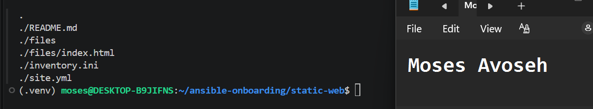
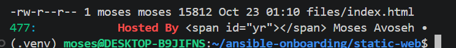
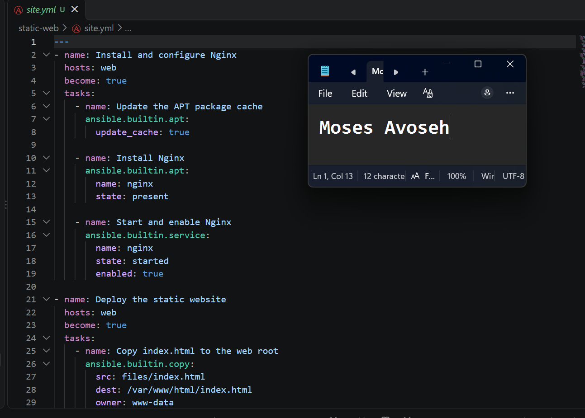
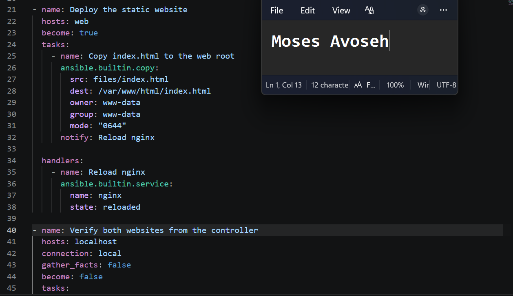
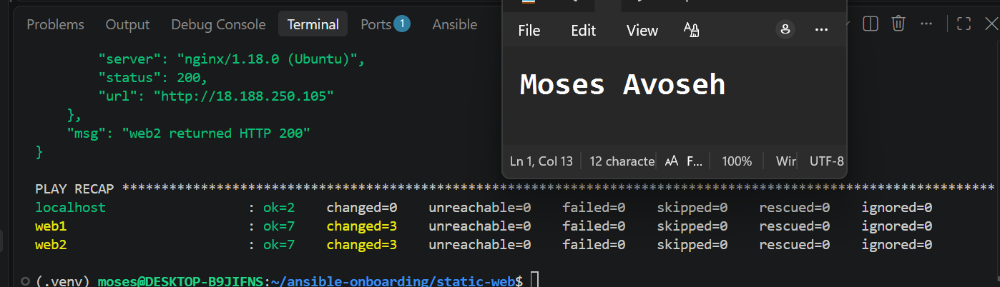
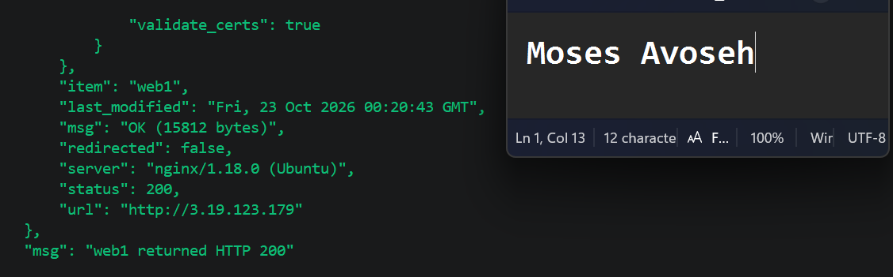
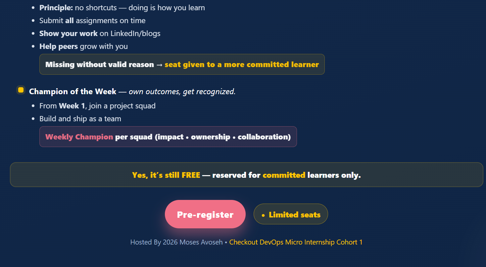

# Assignment 3 — Multi-Play Web Deploy on Azure

Part of the DevOps Micro Internship (DMI) Cohort 3 with Agentic AI

---

## Purpose

In this assignment, you will create one Ansible playbook (`site.yml`) with three plays — install Nginx, deploy a static website with the `copy` module, and verify the deployment from the controller — against the `[web]` group from your existing inventory.

---

# Task 1 — Set Up Folder Layout

## Goal

Create the `static-web` project directory with `inventory.ini`, `site.yml`, a `files/` subdirectory, and `README.md`.

### Evidence

#### Screenshot 1 — Terminal or editor showing the complete `static-web` folder layout

---

# Task 2 — Get the Content

## Goal

Stage `index.html` from `https://github.com/pravinmishraaws/Azure-Static-Website` locally under `static-web/files/`.

### Evidence

#### Screenshot 2 — Editor or terminal showing `files/index.html` staged inside the `static-web` project

---

# Task 3 — Create the Multi-Play Playbook: site.yml

## Goal

Write `site.yml` with three plays: Play 1 (install/start Nginx on `web`), Play 2 (`copy` `files/index.html` to `/var/www/html/index.html` with owner `www-data`/mode `0644`, notifying an Nginx reload handler), and Play 3 (verify every web host with the `uri` module from `localhost`, asserting HTTP 200).

### Evidence

#### Screenshot 3 — Editor showing the three plays in `site.yml`

---

#### Screenshot 4 — Editor showing the copy task, file ownership/mode, handler, uri task, and HTTP 200 assertion

---

# Task 4 — Run the Playbook

## Goal

Run `ansible-playbook -i inventory.ini site.yml` and confirm all plays complete with no failures.

### Evidence

#### Screenshot 5 — Terminal showing the `ansible-playbook` run and final recap with OK/changed results and no failures

---

#### Screenshot 6 — Terminal showing the successful localhost URI verification results

---

# Task 5 — Manual Verification

## Goal

Confirm the deployed static website is reachable directly from a web-server public IP via `curl` and a browser.

### Evidence

#### Screenshot 7 — Browser showing the static website loaded from a web-server public IP

---

### Notes

Describe an issue you faced and how you fixed it, what you learned, why installation and deployment were split into separate plays, and one benefit of using `copy` instead of cloning from Git directly.

### Notes

**Platform note:** I completed this assignment on AWS (Ohio, us-east-2) instead of Azure. I reused the two web servers (web1 and web2) created with Terraform in the previous assignment, with the SSH user "ubuntu" and my Ed25519 key. Ansible ran from my WSL2 Ubuntu 22.04 controller inside the existing .venv.

**Issue I faced and how I fixed it:** Every Ansible run printed pink [WARNING] messages saying the discovered Python interpreter at /usr/bin/python3.10 could change in future. They were harmless, but they cluttered the output and pushed results off the screen. I silenced them by setting ANSIBLE_PYTHON_INTERPRETER=auto_silent for the run, so the recap and verification output fit in one screenshot. I also checked with a ping that both servers were reachable before running the playbook, so connection problems would not be mistaken for playbook errors.

**What I learned:** One playbook can contain several plays, and each play can target different hosts. Plays 1 and 2 ran on the web group over SSH, and Play 3 ran on localhost with a local connection and no fact gathering. A handler runs only when the task that notifies it reports a change, so Nginx reloads only when index.html actually changes. The uri module sends the HTTP request and its status_code parameter sets the expected code. The assert module then checks the returned status value for each server. On the first run, each web server showed changed=3 (cache update, Nginx install, file copy), and failed=0 and unreachable=0 everywhere.

**Why installation and deployment are separate plays:** Installing and configuring Nginx is infrastructure that rarely changes, while website content changes often. Keeping them in separate plays means I can reuse the install logic unchanged and redeploy content without touching the installation. It also makes each play easier to read, test and troubleshoot, and a failure points directly to the stage that broke.

**Benefit of copy over cloning from Git:** The copy module sends the approved file from the controller, so the web servers need no Git installed, no repository access and no credentials. Ansible compares the source and destination and copies only when they differ, so every server gets exactly the same reviewed file and the reload handler fires only on real changes.

---

# Submission Instructions

- Add all required screenshots in your submission
- IP addresses in `inventory.ini` may be redacted
- Do not expose SSH private keys

---

# Completion Checklist

- [✅ Completed] Task 1: `static-web` project structure created (Screenshot 1)
- [✅ Completed] Task 2: `index.html` staged under `files/` (Screenshot 2)
- [✅ Completed] Task 3: Three-play `site.yml` written (Screenshots 3–4)
- [✅ Completed] Task 4: Playbook run successfully with no failures (Screenshots 5–6)
- [✅ Completed] Task 5: Site verified manually via browser (Screenshot 7)
- [✅ Completed] Reflection notes written (Notes)
- [✅ Completed] No sensitive data exposed

---

## 📌 About DMI & CloudAdvisory

DevOps Micro Internship (DMI) is a project-based DevOps program run by Pravin Mishra (The CloudAdvisory) focused on real-world execution, systems thinking, and career readiness.

It helps learners build strong DevOps foundations with hands-on experience.

---

## 📌 Resources

- 🌐 DMI Official Website: https://dmi.pravinmishra.com?utm_source=github&utm_medium=readme  
- 🎓 University: https://university.pravinmishra.com?utm_source=github&utm_medium=readme  
- 💬 Discord Community: https://discord.pravinmishra.com?utm_source=github&utm_medium=readme  
- 📝 Blog: https://dmi.pravinmishra.com/blog?utm_source=github&utm_medium=readme  
- ▶️ YouTube Playlist: https://www.youtube.com/playlist?list=PLFeSNDtI4Cho  
- 🔗 Pravin Mishra (LinkedIn): https://www.linkedin.com/in/pravin-mishra-aws-trainer/  
- 🏢 CloudAdvisory (LinkedIn): https://www.linkedin.com/company/thecloudadvisory/

---

*This submission is part of DevOps Micro Internship (DMI) Cohort 3 — Agentic AI Track.*
