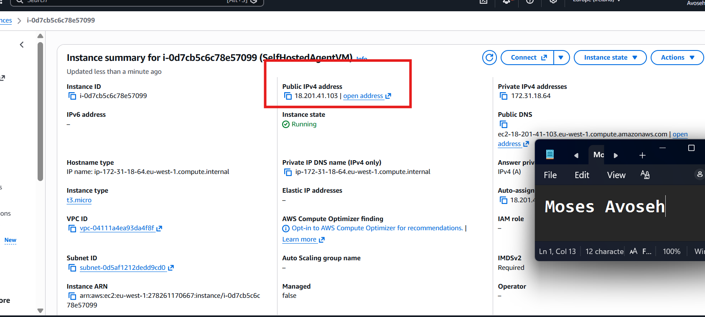
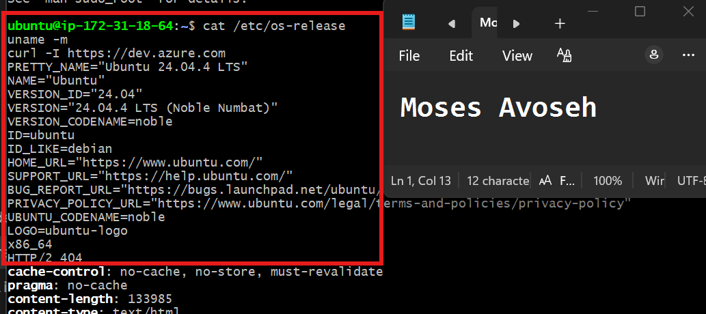
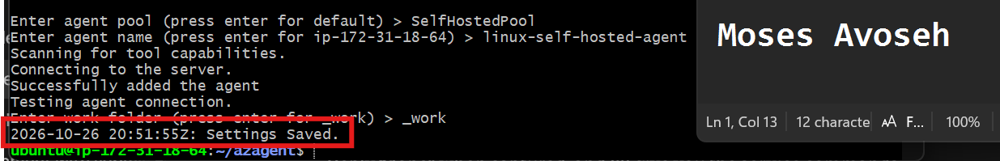
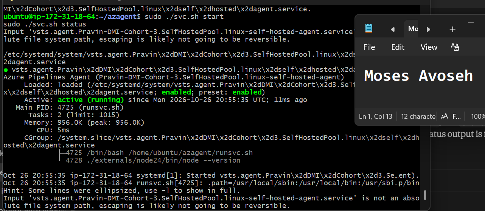
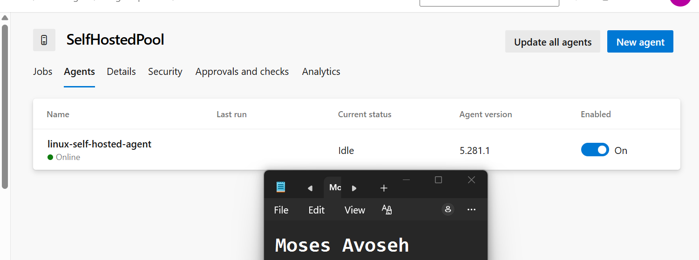
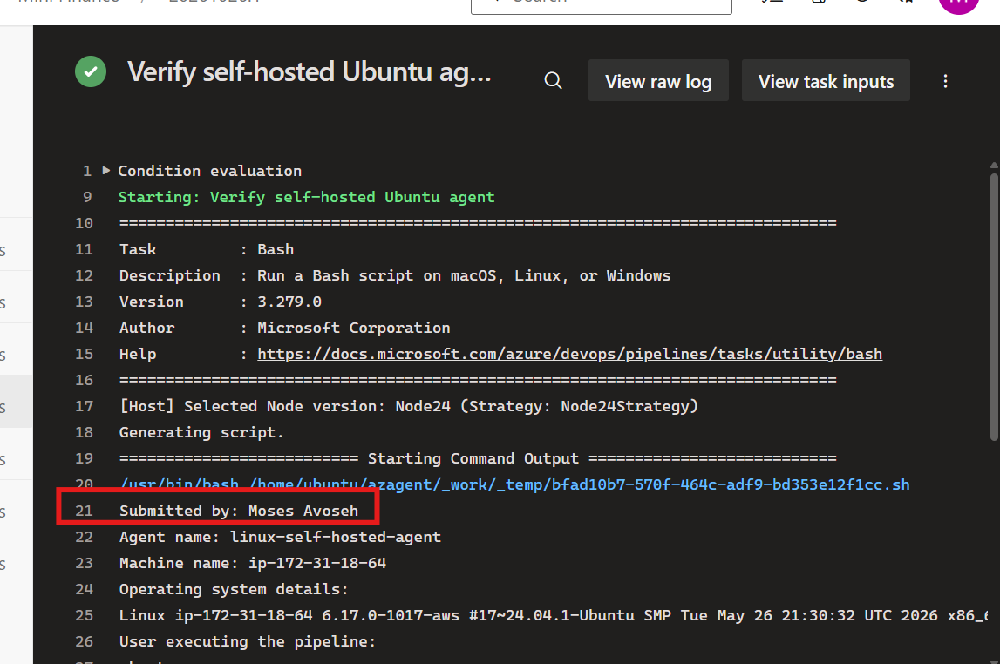

# Assignment 1 — Set Up a Self-Hosted Linux Agent for Azure DevOps (Ubuntu + PAT)

Part of the DevOps Micro Internship (DMI) Cohort 3 with Agentic AI

---

## Purpose

In this assignment, you will set up a self-hosted Azure DevOps build agent on an Ubuntu VM (AWS or Azure), registering it with a Personal Access Token in a dedicated agent pool, running it as a system service, and verifying it by running a test pipeline.

---

# Task 1 — Create a Personal Access Token (PAT)

## Goal

Create a PAT with Agent Pools (Read & Manage) and Build (Read & Execute) scopes, and store it securely.

> No PAT value screenshot required. If you capture the token settings page, ensure the secret value is not visible.

---

# Task 2 — Create an Agent Pool

## Goal

Create a self-hosted agent pool (e.g. `SelfHostedPool`) in Azure DevOps Organization Settings.

### Evidence

#### Screenshot 1 — Azure DevOps Agent Pools page showing the newly created pool

---

# Task 3 — Provision the Ubuntu VM

## Goal

Create an Ubuntu 22.04 (or latest) VM in AWS or Azure with SSH access, and confirm connectivity.

### Evidence

#### Screenshot 2 — Cloud console showing the running Ubuntu VM and its public IP or DNS name

---

#### Screenshot 3 — Terminal showing a successful SSH login and Ubuntu version details

---

# Task 4 — Install and Configure the Agent

## Goal

Download the Linux agent package, register it with your organization/pool/PAT via `config.sh`, and install/start it as a system service.

### Evidence

#### Screenshot 4 — Terminal showing successful agent configuration without exposing the PAT

---

#### Screenshot 5 — Terminal showing the agent service running successfully

---

# Task 5 — Verify the Setup

## Goal

Confirm the agent service is running and the agent shows as Online in the Azure DevOps agent pool.

### Evidence

#### Screenshot 6 — Agent Pool listing showing the registered agent online

---

# Task 6 — Run a Test Pipeline

## Goal

Create and run a YAML pipeline targeting the self-hosted pool, running `uname -a`, `whoami`, and `df -h` on the VM.

### Evidence

#### Screenshot 7 — Successful test pipeline run output in Azure DevOps showing the Linux commands

---

### Notes

Note the cloud platform used, your Azure DevOps organization/project name, and the agent pool name. Describe any issue you faced and how you resolved it.

Cloud platform: AWS (EC2, eu-west-1 Ireland)
Azure DevOps organization: Pravin-DMI-Cohort-3
Project: Mini Finance
Agent pool: SelfHostedPool
Agent name: linux-self-hosted-agent
VM: Ubuntu 24.04 LTS, t3.micro, x86_64

Issue 1: The default VPC in my first AWS region had no subnets, so I could not launch the instance. I switched to eu-west-1 (Ireland), where subnets were available, and the launch worked.

Issue 2: installdependencies.sh printed "Unable to locate package libicu78" and "libicu76". The script tries newer ICU versions first. libicu74 was already installed, which is the version Ubuntu 24.04 uses, so the agent worked fine.

Issue 3: The agent download page showed a retired CDN domain (vstsagentpackage.azureedge.net). I kept the version number and filename and used download.agent.dev.azure.com instead.

---

# Submission Instructions

- Add all required screenshots in your submission
- Do not display the PAT, SSH private key, or other secrets in screenshots or logs

---

# Completion Checklist

- [✅ Completed] Task 1: PAT created with required scopes and stored securely
- [✅ Completed] Task 2: Self-hosted agent pool created (Screenshot 1)
- [✅ Completed] Task 3: Ubuntu VM provisioned and SSH verified (Screenshots 2–3)
- [✅] Task 4: Agent installed, registered, and running as a service (Screenshots 4–5)
- [✅] Task 5: Agent verified Online (Screenshot 6)
- [✅] Task 6: Test pipeline run successfully (Screenshot 7)
- [✅] Platform/org/pool details and issue notes written (Notes)
- [✅] No secrets exposed

---

## 📌 About DMI & CloudAdvisory

DevOps Micro Internship (DMI) is a project-based DevOps program run by Pravin Mishra (The CloudAdvisory) focused on real-world execution, systems thinking, and career readiness.

It helps learners build strong DevOps foundations with hands-on experience.

---

## 📌 Resources

- 🌐 DMI Official Website: https://dmi.pravinmishra.com?utm_source=github&utm_medium=readme  
- 🎓 University: https://university.pravinmishra.com?utm_source=github&utm_medium=readme  
- 💬 Discord Community: https://discord.pravinmishra.com?utm_source=github&utm_medium=readme  
- 📝 Blog: https://dmi.pravinmishra.com/blog?utm_source=github&utm_medium=readme  
- ▶️ YouTube Playlist: https://www.youtube.com/playlist?list=PLFeSNDtI4Cho  
- 🔗 Pravin Mishra (LinkedIn): https://www.linkedin.com/in/pravin-mishra-aws-trainer/  
- 🏢 CloudAdvisory (LinkedIn): https://www.linkedin.com/company/thecloudadvisory/

---

*This submission is part of DevOps Micro Internship (DMI) Cohort 3 — Agentic AI Track.*
