# Assignment 4 — Capstone: Automate the EpicBook Application with Dual Pipelines

Part of the DevOps Micro Internship (DMI) Cohort 3 with Agentic AI

---

## Purpose

In this capstone assignment, you will design a complete DevOps automation workflow for EpicBook across two repositories and two Azure DevOps pipelines: an Infra Pipeline (`infra-epicbook`, Terraform) that provisions the network, frontend/backend VMs, and MySQL database, and an App Pipeline (`theepicbook`, Ansible) that consumes the Terraform outputs, configures the servers, and deploys EpicBook end to end.

---

# Task 1 — Prepare Repositories

## Goal

Prepare `infra-epicbook` (Terraform for network, frontend/backend VMs, MySQL, with `app_public_ip` and `mysql_fqdn` outputs) and `theepicbook` (application code, Ansible roles/playbooks, inventory template, MySQL variable files), keeping infrastructure and application responsibilities separated.

### Evidence

#### Screenshot 1 — Both repositories showing their required files and separation of responsibilities

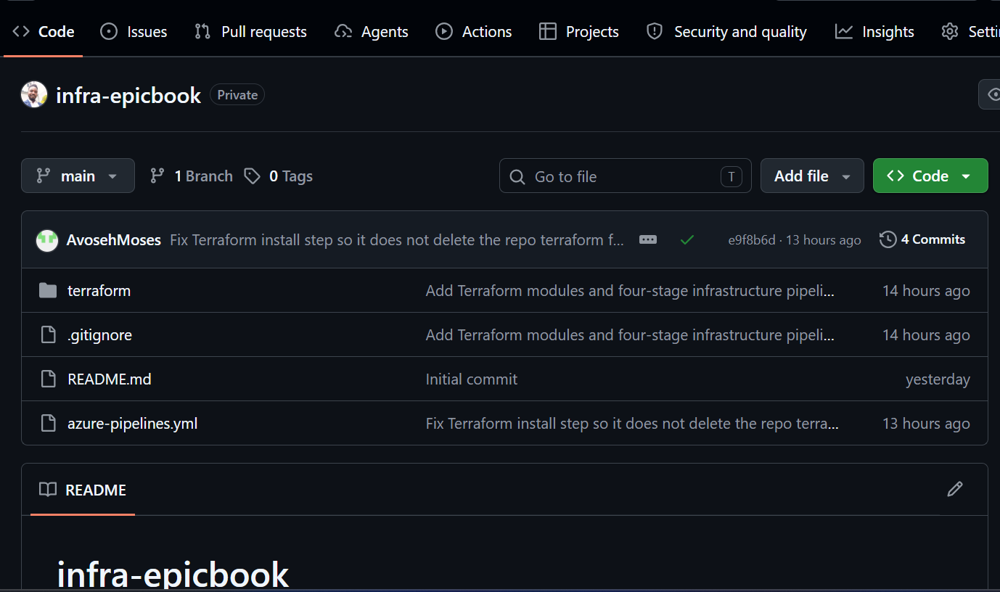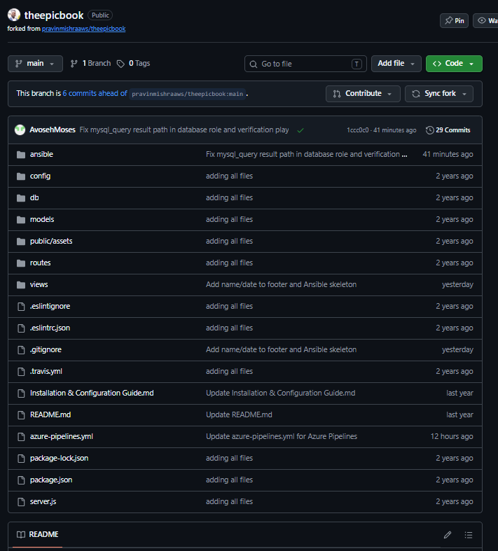

---

# Task 2 — Create Azure Service Connection

## Goal

Create and validate an Azure Resource Manager SPN service connection (Tenant ID, Subscription ID, Client ID, Client Secret) for the Infra Pipeline.

### Evidence

#### Screenshot 2 — Azure Resource Manager service connection showing successful configuration with secrets hidden

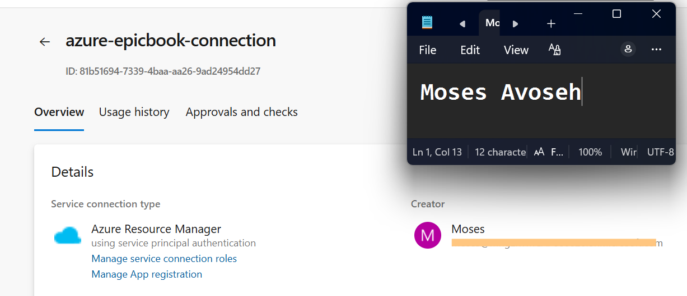

---

# Task 3 — Create Infra Pipeline

## Goal

Create a YAML pipeline for `infra-epicbook` that authenticates via the SPN connection and runs `terraform init`/`plan`/`apply`, producing `app_public_ip` and `mysql_fqdn`.

### Evidence

#### Screenshot 3 — Infra Pipeline run showing `terraform apply` completion and the `app_public_ip` and `mysql_fqdn` outputs

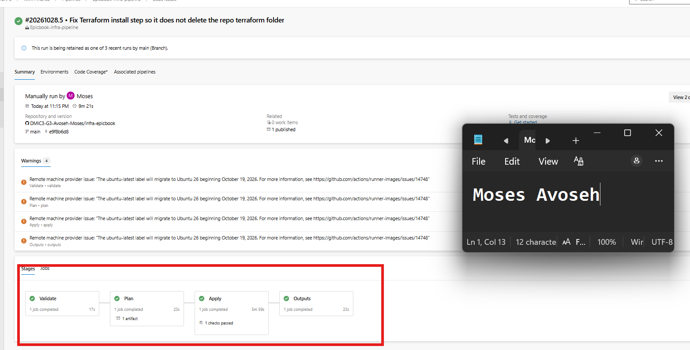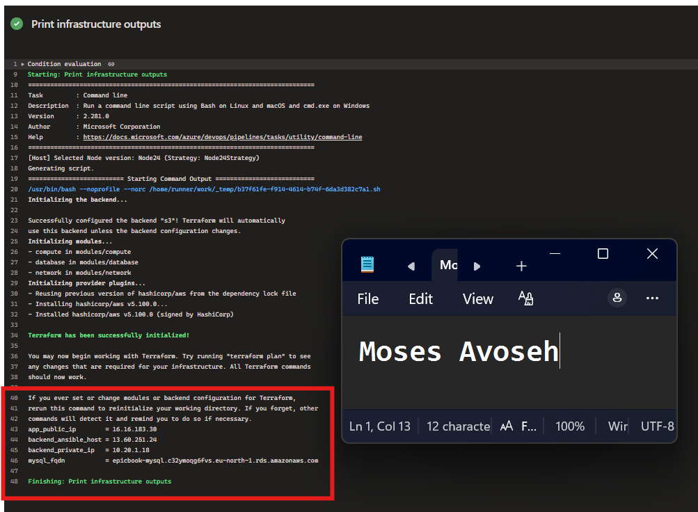

---

#### Screenshot 4 — Azure Portal confirming the provisioned resources

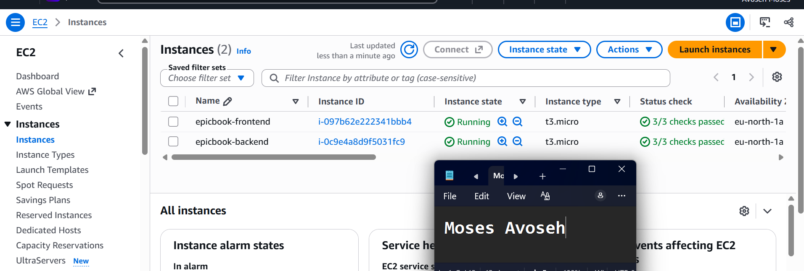

---

# Task 4 — Create App Pipeline

## Goal

Upload the SSH private key to Azure DevOps Secure Files, create a YAML pipeline for `theepicbook` that installs Ansible, downloads the key, manually incorporates the Infra Pipeline's `app_public_ip`/`mysql_fqdn` outputs into the inventory/variables, and runs the playbook to configure the frontend/backend and deploy EpicBook behind Nginx.

### Evidence

#### Screenshot 5 — App Pipeline run summary showing successful completion

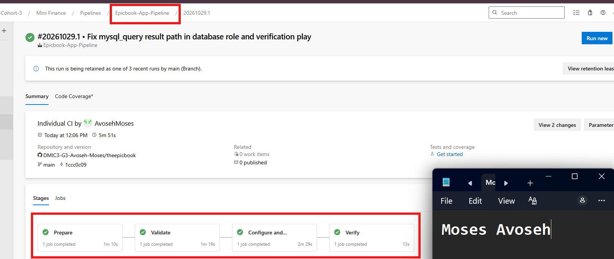

---

#### Screenshot 6 — Ansible playbook output showing successful configuration with `failed=0`

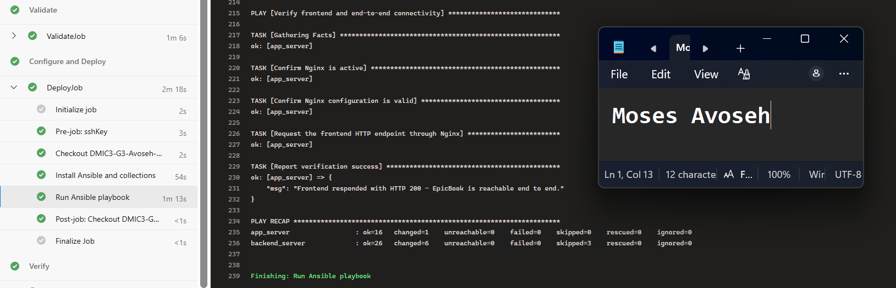

---

# Task 5 — Verify End-to-End Workflow

## Goal

Confirm both pipelines succeeded, the EpicBook application loads through the frontend public IP via Nginx, and a backend feature confirms successful MySQL connectivity.

### Evidence

#### Screenshot 7 — Browser displaying the running EpicBook application with the frontend public IP visible

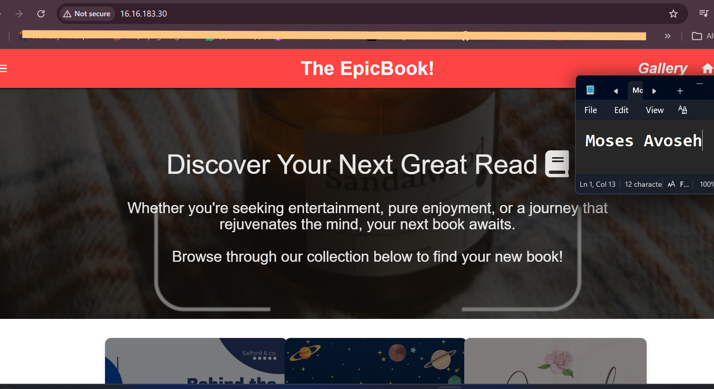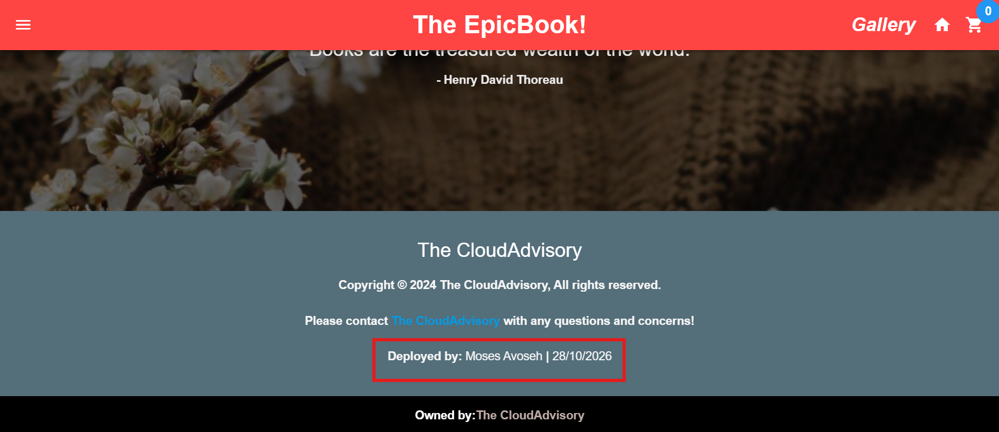

---

### Notes

Record the frontend public application URL and a short issue-and-resolution note, if applicable.

**Frontend public application URL:** http://16.16.183.30

**Architecture:** Browser → Nginx on the frontend EC2 (port 80) → EpicBook on the backend EC2 (port 3000, private IP 10.20.1.18) → Amazon RDS MySQL (port 3306, private access only).

**Cloud provider note:** Azure DevOps ran both pipelines, and the infrastructure was provisioned on AWS (EC2, VPC, RDS, with an S3 + DynamoDB Terraform backend).

**Issues and resolutions:**

1. **Terraform install step deleted the repo's `terraform/` folder.** The Plan stage failed with "No such file or directory". The install script ran `rm -rf terraform` in the checkout root. I moved the install into `$(Agent.TempDirectory)` so it no longer touches the repo.
2. **Infra pipeline failed with `SignatureDoesNotMatch`.** The AWS secret key in the variable group was wrong. I created a new access key for the pipeline IAM user and updated the `Epicbook-aws-secrets` variable group.
3. **Apply stage waited on "Permission needed".** The `epicbook-infra-approval` environment had not been authorized for the pipeline. I created the environment with an approval check and clicked Permit.
4. **Ansible failed at the schema import** with `object of type 'dict' has no attribute 'query'`. The installed `community.mysql` version returns results in `query_result`, so I changed the `when` conditions to `query_result[0][0]` and re-ran. The pipeline then passed with `failed=0` and `unreachable=0`.

**Security:** The SSH key lives only in Azure DevOps Secure Files, the AWS keys and MySQL password are secret variables, and the database tasks use `no_log`. No secrets or Terraform state were committed.

---

# LinkedIn Post (Required)

## Goal

Publish a LinkedIn post about the completed capstone project, mentioning the two-repository/dual-pipeline model, Terraform + Ansible responsibilities, and one end-to-end verification result, with public/"Anyone" visibility and at least one link or image.

## Evidence

#### LinkedIn Post URL

Paste your LinkedIn post URL here:

`https://www.linkedin.com/posts/moses-avoseh_i-just-finished-my-devops-capstone-deploying-share-7521535285516451840-Jb8B/?utm_source=share&utm_medium=member_desktop&rcm=ACoAACZiz20BSL2chCMaU_0WK_2_7qktttgciMQ`

---

#### Screenshot — Published LinkedIn post showing the text and at least one link or image

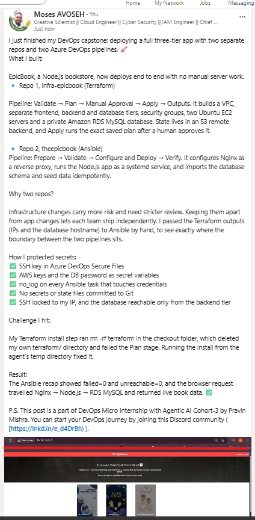

---

# Submission Instructions

- Add all required screenshots in your submission
- Do not commit or expose the Client Secret, SSH private key, database password, or other credentials

---

# Completion Checklist

- [D] Task 1: `infra-epicbook` and `theepicbook` repositories prepared with clean separation (Screenshot 1)
- [D] Task 2: Azure Resource Manager SPN service connection created and validated (Screenshot 2)
- [D] Task 3: Infra Pipeline provisioned resources and produced outputs (Screenshots 3–4)
- [D] Task 4: App Pipeline configured servers and deployed EpicBook (Screenshots 5–6)
- [D] Task 5: End-to-end workflow verified, including MySQL connectivity (Screenshot 7)
- [D] Frontend URL and issue notes written (Notes)
- [D] LinkedIn post published and URL submitted
- [D] No secrets exposed

---

## 📌 About DMI & CloudAdvisory

DevOps Micro Internship (DMI) is a project-based DevOps program run by Pravin Mishra (The CloudAdvisory) focused on real-world execution, systems thinking, and career readiness.

It helps learners build strong DevOps foundations with hands-on experience.

---

## 📌 Resources

- 🌐 DMI Official Website: https://dmi.pravinmishra.com?utm_source=github&utm_medium=readme  
- 🎓 University: https://university.pravinmishra.com?utm_source=github&utm_medium=readme  
- 💬 Discord Community: https://discord.pravinmishra.com?utm_source=github&utm_medium=readme  
- 📝 Blog: https://dmi.pravinmishra.com/blog?utm_source=github&utm_medium=readme  
- ▶️ YouTube Playlist: https://www.youtube.com/playlist?list=PLFeSNDtI4Cho  
- 🔗 Pravin Mishra (LinkedIn): https://www.linkedin.com/in/pravin-mishra-aws-trainer/  
- 🏢 CloudAdvisory (LinkedIn): https://www.linkedin.com/company/thecloudadvisory/

---

*This submission is part of DevOps Micro Internship (DMI) Cohort 3 — Agentic AI Track.*
